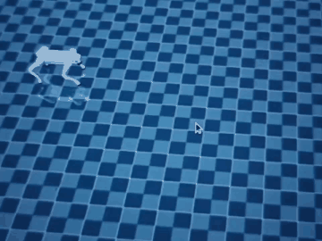
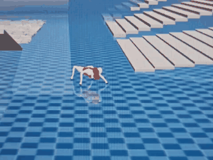
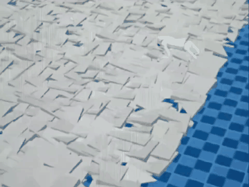

# Go2 Jumping: From PD Position Control to Residual Torque Control

This project develops a Unitree Go2 jumping policy in Isaac Gym and tests its behaviour in MuJoCo. The controller was changed from approximate PD position control to residual torque control. This README explains the main control changes and how to run the simulation demos.

## Simulation demos

The clips below show simulation results. Click a preview to open the full video.

| Straight jump | Load test | Uneven terrain |
|---|---|---|
| [](media/straight_jump.mp4) | [](media/payload_jump.mp4) | [](media/terrain_jump.mp4) |

## Control change

In the original position-control setup, the policy outputs joint-position offsets. A software PD controller turns those offsets into motor torques. The action scale is small because the policy output represents an angle in radians.

In the residual torque setup, the policy output represents an additional torque. A PD controller still provides a stabilizing torque around the default joint pose, and the policy torque is added to it:

```python
def _compute_torques(self, actions):
    p_gains = self.p_gains * self.p_gains_multiplier
    d_gains = self.d_gains * self.d_gains_multiplier

    pd_torques = p_gains * (
        self.default_dof_pos - self.dof_pos + self.motor_zero_offsets
    ) - d_gains * self.dof_vel

    torques = pd_torques + actions
    return torch.clip(torques, -self.torque_limits, self.torque_limits)
```

The policy output therefore changes from a joint-position offset to a residual torque, measured in N·m.

## Main code changes

### Task configuration

The action scale is changed to match the action meaning. For example, `0.25` represents a position offset in radians, while `10.0` represents a torque scale in N·m.

The robot asset is also set to a URDF with effort control enabled:

```python
file = '{LEGGED_GYM_ROOT_DIR}/resources/robots/go2/urdf/go2_torque.urdf'
```

### Torque reward

The torque penalty is changed to penalize the policy's residual action rather than the combined motor torque. This encourages the policy to use only the additional torque it needs:

```python
def _reward_torques(self):
    return torch.sum(torch.square(self.actions), dim=1)
```

## Export a policy

The MuJoCo scripts load a TorchScript policy. Export one from a trained checkpoint with `play.py`:

```bash
# Torque policy
python legged_gym/scripts/play.py \
  --task go2_jump --load_run <run_name> --checkpoint <checkpoint>

# Position policy
python legged_gym/scripts/play.py \
  --task go2_jump_pos --load_run <run_name> --checkpoint <checkpoint>
```

The exported policies are saved under `logs/<task>/exported/policies/`.

## Run a MuJoCo simulation

The torque and position policies can be tested in the same MuJoCo environment. For example:

```bash
# Torque control
python3 deploy_mujoco/sim2sim_GO2_jump_torque_final.py \
  --load_model logs/go2_jump_torque/exported/policies/policy_1.pt

# Position control
python3 deploy_mujoco/sim2sim_GO2_jump_position_final.py \
  --load_model logs/go2_jump_pos/exported/policies/policy_1.pt
```

The torque script uses the torque-control action scale from the training configuration. The position script interprets the policy output as a joint-position target and applies PD control.

Both final scripts support the following test options:

| Option | Description |
|---|---|
| `--load_mass <kg>` | Add payload mass to the robot body. |
| `--terrain` | Use the uneven-terrain scene. |
| `--disable_leg <leg>` | Disable one leg (`FL`, `FR`, `RL`, or `RR`) to test a leg-failure case. |

For example, this command tests the torque policy with a 5 kg payload on uneven terrain:

```bash
python3 deploy_mujoco/sim2sim_GO2_jump_torque_final.py \
  --load_model logs/go2_jump_torque/exported/policies/policy_1.pt \
  --load_mass 5.0 --terrain
```

## Keyboard controls

Click the MuJoCo window to give it focus before using the keyboard.

| Key | Function |
|---|---|
| `W` / `S` | Move forward / backward (`x_vel_cmd`) |
| `A` / `D` | Move left / right (`y_vel_cmd`) |
| `Q` / `E` | Turn left / right (`yaw_vel_cmd`) |
| `J` | Trigger a short forward jump command at 1.0 m/s |
| `I` / `K` | Increase / decrease the global command scale |

For the torque policy, pressing `J` triggers the jump command. Starting with `W` before pressing `J` can make the response easier to observe.

## Development notes

During pure-torque training, the robot sometimes learned to tuck its lower legs to gain the `feet_clearance` reward instead of lifting its body through a coordinated jump. Increasing the posture penalty on the calf joints through `_reward_default_pos` helped reduce this behaviour as the PD contribution faded.

The project also explored higher-speed locomotion and robustness tests. A benchmark checkpoint from 5 March 2026 (`Mar05_07-28-45_`, iteration 3500) tracked up to 4.0 m/s in Isaac Gym and 2.5 m/s in the MuJoCo Sim2Sim setup. Additional tests used 5–8 kg payloads and uneven terrain.

Other changes included phase-aware reward release to reduce unwanted leg motion in flight, aligning angular-velocity conventions between Isaac Gym and MuJoCo, and strengthening calf-joint posture constraints to improve jump form.

## Repository layout

- `legged_gym/` — task environment, observations, rewards, and training configuration
- `deploy_mujoco/` — MuJoCo simulation and Sim2Sim scripts
- `media/` — simulation videos and preview animations
