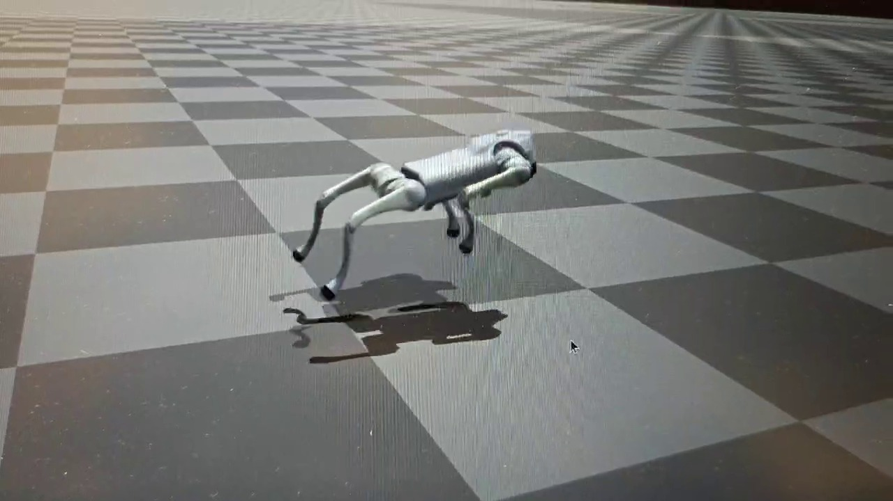
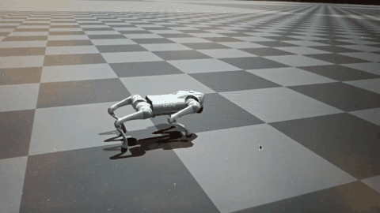

# Goal-Conditioned Jumping for Unitree Go2

A reinforcement-learning project on commanding a quadruped to perform a single jump and land near a target. This repository contains the master's-thesis baseline; the later pure-torque follow-up is documented separately in [SATA](https://github.com/qiwanggoing/Torque-jump).

  

  
  

**Video demos:** [single-jump demo](media/thesis_jump_demo.mp4) · [terrain and robustness demo](media/terrain_robustness_demo.mp4)

## Project

The policy is trained with PPO in Isaac Gym and evaluated in simulation, including Sim2Sim checks in MuJoCo. It uses a jump command, a phase-dependent posture reference, and a small residual PD contribution in the thesis baseline. Training randomizes physical conditions such as robot mass and ground friction to test whether the learned behavior transfers across variations.

The work follows a practical control-development loop: define the commanded jump, train the policy, measure landing and recovery separately, inspect failures, then adjust and retest the controller.

## Thesis-baseline results

| Measure | Result |
|---|---:|
| Landing within 0.10 m of the target | 87% |
| Mean landing error | 0.064 m |
| Strict post-landing settling | 82% |

These results were measured across randomized mass and friction conditions. The follow-up study removes direct PD torque assistance and improves settling, with a measured trade-off in landing accuracy; see the [SATA follow-up](https://github.com/qiwanggoing/Torque-jump).

## Tools

- Python, PyTorch, PPO
- Isaac Gym and MuJoCo
- Torque control and domain randomization

## Repository contents

- `legged_gym/`: task environment, observations, rewards, and training configuration
- `deploy_mujoco/`: MuJoCo simulation and Sim2Sim scripts
- `media/`: short project videos and visual previews

The demonstrations shown here are simulation results; they are not tests on a physical Go2 robot.

